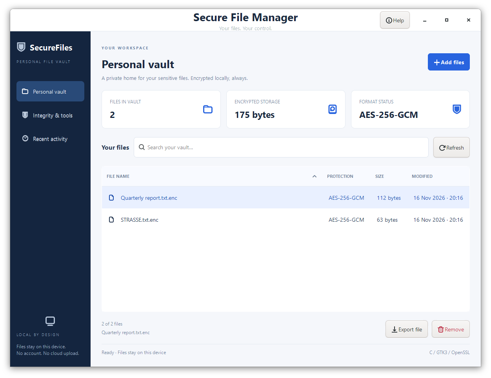

# Secure File Manager

A local file vault and security toolkit built with **C, GTK3, and OpenSSL**. Protect sensitive files, recover encrypted copies, and verify file checksums from a native desktop interface or the command line.

## What's new

- **A redesigned GTK3 workspace:** sidebar navigation, vault statistics, searchable and sortable file metadata, empty states, and clear operation feedback.
- **Batch import and drag and drop:** encrypt several files with one operation. Existing vault entries are preserved; duplicate names are reported.
- **A responsive interface:** encryption, decryption, hashing, and vault scans run on background workers.
- **Authenticated encryption:** new files use AES-256-GCM, independent random salts and nonces, and PBKDF2-HMAC-SHA256 with 600,000 iterations. Older CBC files remain readable.
- **Integrity tools:** calculate SHA-256 or SHA-512, compare a trusted expected checksum, and copy the result.
- **Safer file handling:** outputs never overwrite existing files, failed operations clean up temporary outputs, and vault removal requires confirmation in the GUI and password verification in both interfaces.
- **Operation-scoped passwords:** no default password or saved session password. New GUI passwords require confirmation; a secure random password generator is included.
- **Reliable scripting:** meaningful failure exit codes, checksum verification, and password input through standard input.

The application remains native C with GTK3 and OpenSSL. There is no browser runtime, server, cloud account, or additional production framework.



## Build

Requirements: a C11 compiler, Make, `pkg-config`, OpenSSL 1.1.1 or newer, and GTK3 3.22 or newer. Python 3 is needed only for integration tests.

### Linux

```sh
sudo apt install build-essential pkg-config libssl-dev libgtk-3-dev python3
git clone https://github.com/BroCoder007/secure-file-manager.git
cd secure-file-manager
make -j
```

### macOS

```sh
brew install pkg-config openssl@3 gtk+3
export PKG_CONFIG_PATH="$(brew --prefix openssl@3)/lib/pkgconfig:$PKG_CONFIG_PATH"
make -j
```

### Windows

The primary Windows route remains **WSL with a graphical Linux desktop or WSLg**. Install the Linux dependencies above in your distribution. Keep the project and vault on the Linux filesystem, such as `~/secure-file-manager`, so that owner-only vault permissions work correctly.

A native MSYS2 UCRT64 build is also supported for development:

```sh
pacman -S --needed mingw-w64-ucrt-x86_64-gcc mingw-w64-ucrt-x86_64-gtk3 \
  mingw-w64-ucrt-x86_64-openssl mingw-w64-ucrt-x86_64-pkgconf make python
make -j CC=gcc
```

Run the native binaries from the UCRT64 shell so their GTK/OpenSSL DLLs and GTK resources are available. Native Windows builds inherit directory ACLs; use a private user directory. Unicode paths in the native Windows backend are limited by the C runtime's current code page. WSL uses the POSIX path implementation.

### Build targets

| Command | Result |
| --- | --- |
| `make` | CLI and GTK3 application |
| `make cli` | CLI only; GTK development headers are unnecessary |
| `make gui` | GTK3 application |
| `make test` | CLI integration tests in temporary directories |
| `make gui-test` | GTK workflow integration tests; requires a display |
| `make check` | Build both applications and run integration tests |
| `make sanitize` | Separate AddressSanitizer/UndefinedBehaviorSanitizer CLI build and tests |
| `make clean` | Remove generated build directories and binaries |

## Desktop application

```sh
./bin/secure_gui
```

**Personal vault** shows your encrypted files, sizes, modification times, and encryption format. Add files using the button, a multi-file chooser, or drag and drop. Search by filename and click a table heading to sort. Select a file to export a decrypted copy or remove its vault copy.

**Integrity & tools** calculates and optionally verifies checksums. Select the matching algorithm and paste a full hexadecimal checksum from a trusted source. Standalone encryption and decryption let you choose an output location outside the vault.

**Recent activity** records operations for the current session only. It is bounded and cleared when the application closes.

Shortcuts: **Ctrl+O** adds files, **Ctrl+F** searches the vault, and **F5** refreshes it. Large file operations continue in the background; the application waits for an active operation to finish before closing.

Each file has its own password. When batch importing, the chosen password applies to all files in that batch. Keep generated passwords in a password manager: there is no recovery mechanism. Original input files remain in place.

## Command line

Run commands from the same directory to access the same `.vault`:

```sh
./bin/secure_file_manager --help
./bin/secure_file_manager add private-notes.txt -
./bin/secure_file_manager list
./bin/secure_file_manager retrieve private-notes.txt.enc recovered-notes.txt -
./bin/secure_file_manager delete private-notes.txt.enc -

./bin/secure_file_manager encrypt report.pdf report.pdf.enc -
./bin/secure_file_manager decrypt report.pdf.enc recovered-report.pdf -
./bin/secure_file_manager hash sha256 report.pdf
./bin/secure_file_manager hash sha512 report.pdf
./bin/secure_file_manager verify sha256 report.pdf <expected-64-character-hex-checksum>
```

`-` reads a password from standard input and disables echo on an interactive terminal. The original positional password arguments remain supported, but expose passwords to shell history and process listings. A successful command exits with `0`; invalid arguments, a checksum mismatch, an incorrect password, and file errors return a nonzero status. `hash` prints only the hexadecimal digest for straightforward scripting.

Output paths must be new. Existing destinations, including the input path itself, are refused. Vault entries use the source basename followed by `.enc`; files with the same basename need different source names before import.

## Security and compatibility

New files use a versioned authenticated format. The header, ciphertext, and authentication tag are checked on decryption; a wrong password or modified authenticated file fails without publishing a plaintext destination. Streaming uses 64 KiB buffers, so memory use does not scale with file size. Stronger password derivation deliberately adds a fixed cost per file, while the GTK event loop remains responsive.

Existing files from the original implementation use an 8-byte salt and AES-256-CBC with 10,000 PBKDF2 iterations. They remain recoverable through explicit legacy commands or GUI consent. Normal CLI decryption requires the authenticated format and never silently falls back to CBC when a header is damaged. CBC padding checks **cannot establish integrity or reliably prove a password**. To upgrade, export a legacy file, check its contents, import the recovered file under a new name, and verify the new copy before removing the old one. Keep backups during migration. New authenticated files cannot be opened by older releases.

```sh
./bin/secure_file_manager decrypt-legacy older-file.enc recovered-file.txt -
./bin/secure_file_manager retrieve-legacy older-vault-file.txt.enc recovered-file.txt -
./bin/secure_file_manager delete-legacy older-vault-file.txt.enc -
```

- The vault is `.vault` relative to the process's working directory. Moving the working directory selects a different vault.
- On POSIX systems the vault must be owned by the current user and have mode `0700`. If an existing vault is too open, inspect it and run `chmod 700 .vault`.
- Filenames, sizes, and modification times remain visible. This is file-content encryption, not an encrypted filesystem or a login-protected vault browser.
- Authenticated files have an AES-GCM per-file limit of 64 GiB minus 32 bytes.
- Symlink and special-file inputs are rejected. Successful output publication is atomic and refuses an existing destination. POSIX publication requires a filesystem supporting hard links.
- Decryption uses a private, unpublished temporary file and deletes it on failure. Abrupt termination or power loss can leave a `.sfm-*` temporary file; recovered plaintext outputs should be handled as sensitive files. Only password verification for removal discards plaintext entirely in memory.
- Removing a file unlinks the encrypted copy. It does not guarantee secure erasure from SSDs, snapshots, backups, or journaled filesystems.
- Backups, a private operating-system account, and a strong unique password remain necessary. This project has automated regression tests; it has not received an independent cryptographic audit.

See [the file format](docs/FORMAT.md) and [validation notes](docs/VALIDATION.md) for implementation details and verification results.

## Project structure

```text
gui_gtk.c                 Native desktop interface and background jobs
src/crypto.c, .h          Streaming encryption, decryption, verification, hashing
src/file_manager.c, .h    Shared vault operations and validation
src/main.c                CLI commands and password input
tests/                    Isolated integration tests and legacy fixture
docs/                     Format specification and validation notes
.github/workflows/        Linux build and regression checks
Makefile                  Optimized builds with automatic header dependencies
```

Generated binaries and vault contents are excluded from version control. Build locally from source.

## License

See [LICENSE](LICENSE).
